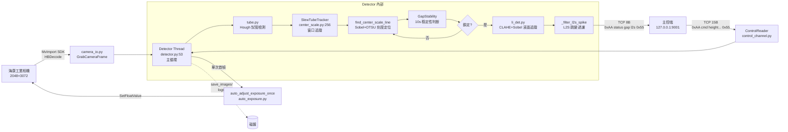
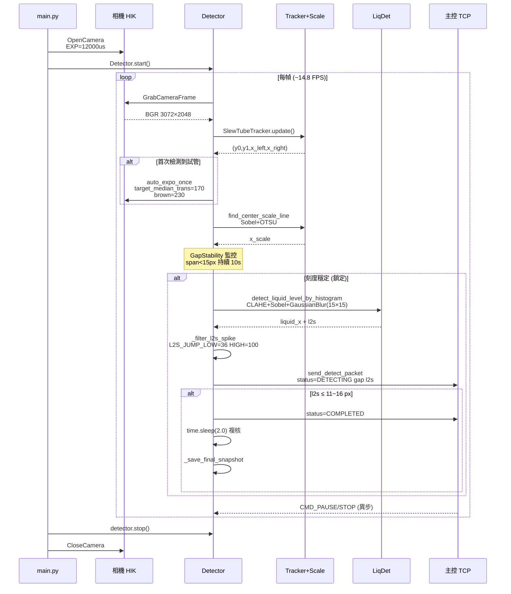

# auto_volume_control 項目全景

> 新負責人 10 分鐘 landing 頁. 讀者: 工程負責人 / 接手工程師 / 匯報對象.

---

## 1. 項目定位

基於海康工業相機 + OpenCV 的試管液位自動追蹤系統. 主控板通過 TCP 下發 START/PAUSE/STOP, 本程序實時輸出液面到刻度線的像素距離 `l2s` + 間隙 `gap`, 主控據此控制滴液泵到達目標刻度即停.

核心業務: **自動加液, 到刻度線停泵, 精度 ±10~16 px** (到達判定 detector.py:826 `abs(l2s_det) <= 11`).

當前最大痛點: **滴液不穩定** — R3 診斷定位三類耦合疑因 (算法無閉環曝光 / 硬件單次開環調光 / 無版本與迴歸), 詳見本文第 5 章.

代碼體量: 主目錄 *.py 共 8126 LOC (detector 1564 / li_det 1050 / center_scale 1128 / det_utils 699 / auto_exposure 484 / debug_stream 425 / liquid_level 446 / 其他 ~2300), 圖像尺寸 3072×2048 (W×H, Mono8), 相機 ResultingFrameRate≈14.8 FPS (曝光 12ms 卡上限, 目標 AcquisitionFrameRate=18.44), 運行平台 Linux/Tegra + Python 3, 單一 detector 線程 + **單連接雙工 TCP** (x5 為 client, 主控 127.0.0.1:9001 為 server, 同一 socket 收發).

---

## 2. 整體架構圖



單線程主處理, 一個背景線程跑日誌 (Asynclogger), 一個背景線程跑 ControlReader TCP 讀. 模塊級全局 `TX_SOCK`/`RUN_STATE`/`CONTROL_READER` 三個單例, 有線程競爭隱患 (R1:316).

---

## 3. 關鍵技術棧

| 類別 | 選型 | 版本/位置 | 備註 |
|---|---|---|---|
| 視覺算法 | OpenCV-Python | requirments.txt (拼錯) | Sobel / OTSU / CLAHE / HoughLinesP / medianBlur / GaussianBlur |
| 數值計算 | NumPy | requirments.txt | `np.percentile`, `np.mean(axis=0)` 投影 |
| 可視化 | matplotlib | requirments.txt | 僅測試腳本用 |
| 相機驅動 | 海康 MvCameraControl SDK | MvImport/ 內置 v4.6.0.1 | GigE/USB3/CameraLink/CXP/XoF 自動探測 |
| 相機接口 | MvCamera + HBDecode | camera_io.py | 海康自研 HB 格式先解碼再轉 Mono8/RGB8 |
| 通信 | TCP (可切 UDP) | control_channel.py, TX_ADDR=127.0.0.1:9001 | big-endian, 8B 發送 / 15B 接收, 0xAA + 0x55 包頭包尾 |
| 配置 | os.getenv + rt_config.py | 27 處 getenv | 環境變量覆蓋硬編碼, 無 schema 驗證 |
| 日誌 | 自研 Asynclogger | logger_utils.py | 隊列驅動 + 24h 自動清理, 無 rotation, 無 DEBUG 級別 |
| 線程模型 | threading.Thread + daemon | detector.py:53 | 主 Detector + 日誌 + ControlReader 三線程 |

**不在技術棧**: 無 CI/CD, 無 Makefile, 無 Dockerfile, 無 pytest 或單測框架 (R3:3.3).

**OpenCV 算子落點速查** (R1 梳理):
- `cvtColor / GaussianBlur / Sobel` 出現 4 次以上, 是主邊緣提取鏈
- `threshold(OTSU)` 2 處, 是刻度線二值化骨幹 — 也是第 5 章 S2 的痛點源
- `CLAHE` 1 處 (li_det.py:24), 做亮度歸一預處理, 是整個項目**唯一的光照補償手段**
- `HoughLinesP / Canny` 僅 detect_liquid_level.py (備用管道) + tube.py (試管邊界) 用, 主鏈不走 Hough
- `morphologyEx(MORPH_OPEN, (80,1))` 僅 1 處 (li_det.py:41 定義核 + L45 應用), 核大小硬綁 ROI, 換分辨率就崩

---

## 4. 核心流程



**關鍵狀態機**: NO_TUBE → INIT → DETECTING → COMPLETED (+ PAUSED/STOPPED/RECHECK_FAIL 分支). 狀態枚舉定義在 `rt_util.py:240-246` (含 7 個碼, 6 保留), 打包位置在 `rt_util.py:140` (`status_byte = int(task_status) & 0xFF`) 再封入 7/8B 發送幀. 實現方式不是經典 FSM — 就一個整數 `self.current_status`, 分散在 detector.py **13 處** `self.current_status = rt_util.UpdateStatus(NEW, self.current_status)` 命令式賦值 (L639/661/671/673/878/880/1103/1220/1492/1522/1524/1526). 無轉移表、無 guard. `UpdateStatus()` (`rt_util.py:261-272`) 只做「值變化才打印」一件事, 不是 FSM 引擎. 狀態字段**同時擔任內部業務分派鍵** (run() L1518-1526 讀它決定走鎖定模式還是刻度檢測模式) **和協議輸出字段** — 雙職耦合, 任何內部 phase 重構都會改變上報字節. `STATUS_*` 使用只在 rt_util.py + detector.py 兩個文件, 沒污染算法模塊.

**刻度鎖定觸發**: `GapStability.is_stable()` 滑動窗口 10s + 樣本 ≥3 + 波動 <15 px (detector.py:57-59). 鎖定後切綠色通道 + 15×15 Gauss + Sobel ksize=5 (detector.py:787-808), 放棄 OTSU 改用 histogram 直方圖追液.

**到達判定**: 未鎖定用 `abs(l2s_det) <= 11` (detector.py:826), 鎖定用 `l2s_disp <= 16` (detector.py:1086). 兩個閾值不對稱, 歷史原因不詳.

**複核分支**: 到達後 `time.sleep(2.0)` 停泵, 再跑一次 `_run_recheck` (detector.py:737). 複核失敗**無重試**, 直接進入空閒態 (R1:64) — 這是個潛在坑: 如果滴液後液面晃動 2 秒沒平, 複核就誤判失敗, 但主控已經停泵了.

**重點旁支**:
- `_filter_l2s_spike`: 基於 `L2S_SPIKE_STREAK=3` (液面跳變連續幀數閾值, 下文簡稱 STREAK) 判斷跳變; 小值 <500 / 大值 >700 會被吞掉 (R2:40-43). 濺起瞬間的高值可能被當作 spike 過濾掉, 造成主控「看不見液面已到」而繼續滴.
- `reset_liquid_confidence`: liquid_level.py 內, 置信度狀態重置口 (R2:270). 目前只在鎖定切換點調, 沒在濺起恢復時調.

---

## 5. 現狀診斷 (核心章)

滴液不穩定的根因定位: **三層耦合, 互相掩蓋**. 下面按軟件 / 硬件 / 項目化三類展開, 結論來自 R3 實測 + R1/R2 代碼定位.

### 5.1 軟件識別層 (algo)

算法主線路 OpenCV 鏈已在 R1 梳理清楚 (R1:17-30 未鎖模式 / R1:26-31 鎖定模式). 問題不出在個別算子選得差, 而是**全鏈路假設固定輸入**, 一旦環境光/分辨率/RGB 順序變動就集體失效.

| # | 問題 | 具體證據 | 嚴重性 |
|---|---|---|---|
| S1 | 曝光僅首幀調一次, 無閉環 | detector.py:1511 `AUTO_EXPO_ONCE` 分支; auto_exposure.py:154 名字就叫 `auto_adjust_exposure_once`. R3:1.1, R3:2.1 | H |
| S2 | 液面檢測二值化走 OTSU, 對光照敏感 | li_det.py:31-32 `THRESH_BINARY+THRESH_OTSU`; detect_liquid_level.py:23 `Canny(30,100)` 閾值也寫死. R3:1.2 | H |
| S3 | 硬編碼 ROI `[500:1500, 500:1900]` 只對 2048×3072 有效, 換相機即失效 | li_det.py:44, detect_liquid_level.py 同坐標. 另 li_det.py:194 把 y=1024 寫死為中點截止. R3:1.3, R1:145-146 | H |
| S4 | 綠色通道寫死 `img[:,:,1]`, RGB/BGR 弄反直接誤判 | li_det.py:20. R1:144 | M |
| S5 | 16 個 bare except, 吞掉關鍵錯誤 | detector.py 通篇; center_scale.py:695-760 refine 區大量 try-except 靜默失敗. R3:1.4, R1:326-329 | M |
| S6 | L2S 跳變過濾 7+ 個硬編碼閾值, 無自動調校 | rt_config.py `L2S_JUMP_LOW=36, HIGH=100, SPIKE_LOW_MAX=500, SPIKE_HIGH_MIN=700, STREAK=3, NEAR_RADIUS=200, JUMP_CONFIRM_RADIUS=300`. R3:1.5, R2:38-46 | M |
| S8 | 170 個 print() 直接出控制台, 日誌只有 INFO/WARN/ERROR 三級 | grep 統計; logger_utils.py 無 DEBUG 級別. R3:1.7 | M |

算法鏈裡最脆的點: **li_det.py 校準 13 步流水線** (R1:86-99), 任一步邊緣圖失真都會被 `cv2.bitwise_and` 放大. 且 L44 `morphologyEx` 用 `(80, 1)` 核去水平連通, 核大小直接硬綁在 ROI `[500:1500, 500:1900]` 上 — ROI 變, 核的相對比例就失配.

### 5.2 硬件層 (曝光 + 滴液裝置)

| # | 問題 | 具體證據 | 嚴重性 |
|---|---|---|---|
| H1 | 曝光 step_up=1.8×, step_down=0.6×, first_base=12000us — 保守且一次性 | auto_exposure.py:168-171, R2:171-174. R3:2.2 | H |
| H2 | `EXP_BOOT_US=12000` 啟動硬塞, 後續無環境光自適應 | camera_io.py + rt_config.py:22-26. R3:1.1 | H |
| H3 | 相機反饋只有命令解析, 無曝光/聚焦回報 | 發送幀打包在 `rt_util.py:140-181` (7B std 或 8B cpp 布局), 只含 `status/gap/l2s`, 沒有 exposure/gain/focus 狀態. 上位機 `control_channel.py:152-236` 只收不回. R3:2.3 | M |
| H4 | 試管窗口 slew 非對稱 (left_inc_max=10, right_dec_max=10), 光反射易漂移無恢復 | center_scale.py:264-291, R1:223. R3:2.4 | M |

這塊問題在滴液抖動時放大: 液面濺起反光 → 第 N 幀灰度飆升 → OTSU 閾值變 → 液面邊緣丟失 → l2s 跳變 → 過濾器吃掉或放行錯值 → 主控錯誤停泵. 而 `auto_expo` 函數名就白寫了 `_once`, 語義上工程師已經承認它不是閉環 (auto_exposure.py:154), 但沒人把它改成周期重評.

另外硬件層還有個隱蔽坑: `first_up_abs_max=30000` 把第一次向上調曝光的絕對上限寫死成 30 ms (auto_exposure.py:171), 對弱光/棕色試管這個上限可能不夠 — 但現場目前沒遇到, 所以沒人動, 先記一筆備查.

### 5.3 測試流程閉環缺失 (project)

| # | 問題 | 具體證據 | 嚴重性 |
|---|---|---|---|
| P1 | 無版本管理, best/ 三副本與主目錄有分歧無記錄 | rt_config.py diff 6 行. git log 僅 9 commits. R3:3.1, R3:3.2 | H |
| P2 | 無 CI/CD, 無 Dockerfile, 無 Makefile, tests/ 669 行 4 文件無執行腳本 | R3:3.3 | H |
| P3 | requirments.txt 拼錯且只列 3 行, MvImport 依賴未說明 | R3:3.4 | M |
| P4 | 配置分散: 27 處 getenv + 代碼內常數 + 無默認值文檔 | R3:3.5, R2:20-56 | M |
| P5 | 日誌 24h 自動清理, 無轉儲, 無歸檔 | logger_utils.py:18 `max_age_seconds=24*3600`. R3:3.6 | M |
| P6 | 無迴歸測試數據集, 參數試驗無法溯源 | save_images/ + logs/ 手動, 無命名規範. R3:3.7 | M |
| P7 | main.py bare except, 無相機連接/配置校驗 | main.py:23-24. R3:3.8 | M |

`best/` 目錄藏了一個**版本管理漏洞**: 主目錄與 best/ 有分歧無記錄, 沒人記錄哪個是「穩定版」. 一旦滴液回歸出問題, 無法二分定位.

R3:39-61 已把 diff 列出來了 — rt_config.py 相差 6 行, li_det.py 零差異. 沒打 tag 任何一次回歸出錯, 都沒人敢動 best/.

### 5.4 性能瓶頸診斷 + 優化評估 (2026-04-24 補入)

**背景**: detector 主循環在 x5 上跑不滿 14.8 FPS 上限; 液面到達刻度線時滯後感明顯, MJPEG 調試流觀察「一卡一卡」.

**每幀真跑的熱點** (親自核驗 detector.py:1100-1564 + li_det.py:640-730):

| # | 熱點 | 估開銷 | 跑在哪 | 證據 |
|---|---|---|---|---|
| A1 | 全圖 `GaussianBlur(bgr[:,:,1], (15,15))` | **6.3M 像素, x5 估 20~30ms** | 鎖定後**每幀** | li_det.py:659 |
| A2 | ROI 內 `Sobel` ksize=5 | 中 (ROI 依賴) | 鎖定後每幀 | li_det.py:670 |
| A3 | `cvtColor(bgr, BGR2GRAY)` 亮度維持 | 6.3M 像素 | 鎖定每幀 | detector.py:1032 |
| A4 | `find_center_scale_line` 完整鏈 (含 cvtColor + Sobel) | 中 (band=50) | 未鎖定每幀 | center_scale.py:698 |

**A1 是最大單點**; 鎖定態 debug_stream「一卡一卡」主因就是這一步 — 全圖 15×15 Gaussian 在 Tegra 上估 20~30ms, 單這一步就把 FPS 上限打到 33~50 Hz 以內, 再疊加其他階段就跑不滿 14.8 了.

**已節流, 不是熱點**:
- `SlewTubeTracker.update` (Hough) — `update_every=10` 幀才跑一次 (center_scale.py:329)
- `refine_scale_edges` — 鎖定事件**一次性**, 之後不再跑 (detector.py:1281-1307)
- `calibrate_first_frame` — 首幀一次 (li_det.py:540-570)

**5 個調試流底圖繼承** (關係到「可視化合併」):
- `tube_viz` + `scale_refine_overlay` + `liq_viz` → 底圖都是 bgr (或帶紅色 tube mask 疊加). `scale_refine_overlay` 繼承 `state.viz` 當底圖 (center_scale.py:1014 `base = getattr(state, 'viz', None); vis = base.copy()`), 所以紅色 tube mask 會原樣出現, 只是疊加額外的刻度線標識.
- `center_scale` → 獨立 Sobel 投影圖 (find_center_scale_line 生成)
- `scale_refine_profile` → 獨立 800×200 折線圖 (異類, 不適合合併)
- **觀察**: `liq_viz` 的 `liq_overlay` 變量**全局為 None** (li_det 沒返回 overlay), detector.py:1160 落回 `vis_liq = bgr_image.copy()`. 當前 MJPEG 看到的 liq_viz 只有黃綠目標線, **看不見液面邊緣檢測中間過程** — 這是可視化的真實 gap.

**紅色 mask 含義辨正** (center_scale.py:487-491): `overlay[m>0]=(0,0,255)` 把 `state.mask` (uint8 0/255, tube 幾何檢測產物) 以 40% 紅疊加. **這紅色是 tube ROI 標記, 不是圖像二值化 (OTSU) 的輸出**. 下游 `find_center_scale_line(..., st.mask, ...)` (detector.py:1228) 用它限定搜索範圍; `refine_scale_edges(use_mask=True)` 用它給列能量加權 (center_scale.py:912-918). 真正的圖像二值化 (OTSU) 在 li_det.py:31-32 和 center_scale.py 內部, 和這個紅蒙版沒直接關係.

**存圖 IO 現狀** (5 處):
- 主循環 IO 已集中到單線程 async queue: `_img_save_worker` + `_img_save_queue` (detector.py:368-418), `put_nowait` 丟棄保護
- 離線 imwrite 只在 CLI/DEBUG_OFFLINE 分支: center_scale.py:1121, li_det.py:820, liquid_level.py:446 — **不在主循環**
- **IO 不是瓶頸**; 感覺「混亂」來自目錄規則散 (`save_images/` 根 vs `logs/process_frames/session_*/`), 不是 IO 本身多

**優化路線** (優先級排序, 實測前估算):

| 方案 | 估值 | 風險 | 前置 |
|---|---|---|---|
| **前置: profiling 樁點** | — | 低 | detector.py:1473 前後 + 各階段插 `time.monotonic()`, 每 N 幀 (默認 30) 匯總 `fps avg/max + grab/cvt/track/process/total 各階段 avg/max ms` 一行到 logger. env `DETECTOR_PROF=1` 開關. x5 上跑 60s 收數據. **沒實測就盲調**. |
| 方案 A: 降分辨率分層 | **30~45% CPU** | 中 | 實測確認 A1/A4 是主瓶頸. tube + 粗搜 → 1/4 分辨率 (768×512, 省 16×), refine + 液面 → 原分辨率 ROI crop. 配套改: 硬編碼 ROI `[500:1500,500:1900]` (li_det.py:44) + morphologyEx 核 `(80,1)` (R2 提及) 要同步動, 否則比例失配. |
| 方案 B: 合併可視化 + mask 瘦身 | 5~10% 幀時間 | 低 | `tube_viz + liq_viz` 合成單幅 (共 bgr 底圖, 疊不同邊界線); 紅 mask 改純邊界線版; mask 二值圖在鎖定事件一次 dump 供離線看; 補全 liq_viz 中間結果 overlay. 順帶糾偏 `_show_frame_unlocked` 裡 tube_viz/liq_viz 的 3 次 `.copy()` 共享. |
| 方案 C: 消重複計算 | 10~15% | 低 | detector.py:1032 亮度維持 cvtColor 與 li_det 內部 gray 提取合併 (傳 gray 進 `detect_liquid_level_by_histogram`); 各 viz `.copy()` 共享同一 base. |

**執行工具** (已備, 用戶自執行): `docs/scripts/x5-patch.sh` (Orin workdir → x5 patch + apply) · `docs/scripts/x5.sh` (ssh 看 log / 一次性命令) · `docs/scripts/probe_camera.py` (曝光/幀率/像素格式 probe, detector 要停) · `docs/scripts/run_stream_test.sh` (debug_stream e2e harness).

---

## 6. 風險矩陣 (TOP 8)

| # | 風險 | 嚴重性 | 影響面 | 證據 |
|---|---|---|---|---|
| R1 | 曝光非閉環, 環境光變化直接炸液面檢測 | **H** | 滴液穩定性 (核心痛點) | auto_exposure.py:154, detector.py:1511, R3:1.1/2.1 |
| R2 | 硬編碼 ROI `[500:1500, 500:1900]` 只適配 2048×3072 | **H** | 換相機即廢 | li_det.py:44, R1:145 |
| R3 | OTSU 二值化 + 固定 Canny 閾值對光照/反光敏感 | **H** | 滴液濺起時誤判 | li_det.py:31-32, detect_liquid_level.py:23, R3:1.2 |
| R4 | best/ 三副本無版本標記, 有分歧無合併記錄 | **H** | 無法溯源不穩定參數改動 | R3:3.1/3.2 |
| R5 | 無迴歸測試 + 無 CI, 改一行上不了鎖 | **H** | 試驗參數等於賭命 | R3:3.3 |
| R6 | 模塊全局單例 + 未加鎖的曝光調整 | M | 潛在競爭, 偶發 bug 難複現 | detector.py:27-29, L840-843, R1:316-318 |
| R7 | 16 bare except 靜默失敗 | M | 調試困難, 關鍵錯誤沉默 | detector.py, center_scale.py:695-760, R3:1.4 |
| R8 | 液面單調約束無歷史清理, long-term drift 無防守 | M | 長時間運行逐漸偏移 | detector.py:878-884, R1:67 |

---

## 7. 改進路線圖

### 優先級 × 時間雙軸

| 動作 | P0 (阻塞痛點) | P1 (穩定性) | P2 (工程化) |
|---|---|---|---|
| **1 月內** | (1) 曝光閉環: AUTO_EXPO_ONCE 改 30 幀重評, 記錄曲線 對比穩定/不穩定期 <br/>(2) 提取所有硬編碼閾值到 rt_config.py, 環境變量覆蓋 + 啟動打印 <br/>(3) best/ 廢棄改 git tag, README 交代策略 | 日誌新增 DEBUG 級別, 關鍵決策點 (曝光/鎖定/l2s 跳變) 降級成 DEBUG; print() 統一改 logger | — |
| **3 月內** | 液面檢測二值化替換: CLAHE 先歸一 + 自適應閾值 (adaptiveThreshold) 取代 OTSU, 在 3~5 組典型光照集上打分 | (1) ROI 參數化綁相機分辨率, 支持 1080p/4K 多設備 <br/>(2) 引入迴歸測試集 (good/bad/splash 三類 × 5 組), pytest 自動化 <br/>(3) 16 個 bare except 逐一替換具體異常 | 引入 Pydantic 配置驗證框架, rt_config.py 啟動期校驗 (如 `L2S_JUMP_LOW < HIGH`) |
| **6 月內** | 滴液閉環: 主控回報實際體積, Detector 根據誤差反向調節 (機制待設計), 形成雙環控制 | (1) GitHub Actions/GitLab CI 自動跑迴歸 <br/>(2) 相機參數 TCP 雙向回報 (曝光/聚焦/增益) <br/>(3) 試管追蹤加光反射恢復邏輯 | 結構化日誌 JSON 化, 對接 ELK/Grafana; Dockerfile 化部署 |

**硬優先級排序**:
- P0 阻塞滴液穩定, 一個月內必須見效 (R3:4 P0 三條均歸入).
- P1 決定系統能否跨相機/跨燈光場景.
- P2 是長期工程化, 不解決不影響出貨但影響下一個版本迭代速度.

### 1 個月內見效 3 個動作 (抄自 R3:96-99, 直接可執行)

1. **Week 1-2**: 所有硬編碼閾值提出到 rt_config.py + 環境變量; 日誌在 `auto_adjust_exposure_once` 前後打印 (prev_exp / new_exp / median / sat_ratio).
2. **Week 2-3**: 改 `AUTO_EXPO_ONCE` 成 30 幀周期重評 (加 throttle 防過頻); 記錄曝光變化曲線, 對比**滴液穩定期 vs 不穩定期**的曝光軌跡 — 這是定位痛點根因的關鍵數據.
3. **Week 3-4**: 構建迴歸集 (光好/光差/濺起 ×3~5 組 = 9~15 組), 寫 `tests/test_regression.py`, 斷言 `l2s` 誤差 < 10 px; 加 git pre-commit hook.

三步後, 即使痛點沒消失, 至少**有數據能證明是哪一環崩的**. 現在最要命的是調個參數全憑手感, 改完開機測 10 次看有沒有復現, 沒有迴歸集就是盲調.

---

## 8. 附錄

### 8.1 文件地圖

| 路徑 | 職責 | LOC 級別 |
|---|---|---|
| `main.py` | 入口, 相機開/檢測器啟/清理 | 小 |
| `detector.py` | 檢測主循環線程 (狀態機 + OpenCV 鏈) | **大** (~1400) |
| `li_det.py` | 液面檢測核心 (CLAHE + Sobel + histogram) | 大 |
| `detect_liquid_level.py` | 獨立液面管道 (測試/備用, Hough+Canny) | 中 |
| `center_scale.py` | 試管追蹤 + 刻度定位 + 精修 | 大 |
| `tube.py` | Hough 試管邊界檢測 (被 center_scale 調) | 中 |
| `liquid_level.py` | 液面置信度與備用檢測 | 中 |
| `gap_stability.py` | 刻度穩定性滑窗判斷 | 小 |
| `det_utils.py` | 檢測輔助函數 | 小 |
| `camera_io.py` | 海康相機生命周期封裝 | 中 |
| `capture_single_image.py` | 單幀採集工具 | 小 |
| `auto_exposure.py` | 單次自動曝光調整 | 中 |
| `control_channel.py` | TCP 控制通道 (RunState + ControlReader) | 中 |
| `rt_config.py` | 配置中心 (27 處 getenv) | 中 |
| `rt_util.py` | 打印/TCP 工具 | 中 |
| `logger_utils.py` | Asynclogger | 小 |
| `collect_debug_data.py` | save_images/ 歸檔工具 | 小 |
| `MvImport/` | 海康 SDK (v4.6.0.1, 內置) | 極大 (~10k) |
| `tests/` | fake_start / test_tcp_cmd / test_liqure / test_logger.ipynb | 669 |
| `best/` | detector/li_det/rt_config **歷史副本** (無版本標記, **待廢棄**) | 中 |
| `docs/internal/` | R1/R2/R3 調研 (本文素材) | 856 |

### 8.2 飛書協議文檔

TCP 協議格式詳見倉庫內 `说明文档.md` 第 1 節 (Feishu Wiki 鏈接). 發送/接收幀結構已在 R2:131-145 定稿, 可直接據此接新主控.

### 8.3 關鍵配置 Top 10 一瞥 (rt_config.py)

| 配置項 | 默認值 | 關鍵性 |
|---|---|---|
| `EXP_BOOT_US` | 12000.0 | 啟動曝光, 決定首幀能否看到液面 |
| `AUTO_EXPO_ONCE` | True | 首次試管後單次調光, **痛點源頭** |
| `TX_ADDR` | 127.0.0.1:9001 | 主控地址, 部署時必改 |
| `L2S_JUMP_LOW / HIGH` | 36 / 100 | 液面跳變過濾閾值 |
| `LIQ_NEAR_RADIUS` | 200 | 進入液面確認水平距離 |
| `LIQ_WARMUP_DETS` | 3→10 | 液面檢測保護期 |
| `SCALE_REFINE_BAND` | 9 | 刻度精修帶寬 |
| `FINAL_SNAPSHOT_PATH` | ../new_test/images/liq_final.png | 快照路徑, 相對路徑坑 |
| `SHOW_WINDOWS` | 有 DISPLAY 則 True | 生產環境部署必須關 |

全部配置項(32 個)見 R2:22-56 總表.

### 8.4 關鍵入口速查

- 運行主程序: `python main.py`
- 手工測 TCP 控制: `python tests/test_tcp_cmd.py [port]`
- 模擬主控發 START: `python tests/fake_start.py`
- 歸檔本次調試圖: `python collect_debug_data.py --dest-root /path --src ./save_images`

### 8.5 TCP 協議位定義 (速查, 接新主控時必看)

**發送幀 (Detector → 主控, cpp 布局 8 字節)**:
```
[0xAA] [status:1B] [gap:2B big-endian] [l2s:2B big-endian] [0x55]
status: 0=NO_TUBE 1=INIT 2=DETECTING 3=COMPLETED 4=PAUSED 5=STOPPED
gap:    刻度間隙像素, 10000 表無效
l2s:    液面到刻度線像素距離, 10000 表無效
```

**接收幀 (主控 → Detector, 15 字節)**:
```
[0xAA] [cmd:1B] [height:4B be float] [scale_height:4B be float] [volume:4B be float] [0x55]
cmd: 0=NONE 1=START 2=PAUSE 3=STOP
```

**std 布局 (7 字節)**: little-endian 版本, 在 `TX_LAYOUT='std'` 時啟用, 但代碼中**未實際檢查** (R2:29 標注). 生產環境一直用 cpp.

**無握手, 單向**: ControlReader 解析失敗只 log 不回 ack (R2:147-150). 主控看不到命令是否被接受, 這在調試期給排障造成過多次「到底誰斷的」扯皮.

### 8.6 接手第一周建議動作

1. 跑通 main.py + fake_start.py 閉環, 確認自己機器能看見 l2s 實時輸出 (TX_ADDR 可改成自己的 IP).
2. 讀 detector.py run() 主循環 + 狀態機, 對照本文第 4 章時序圖. 重點看 `_handle_control_command` / `_filter_l2s_spike` / `_check_liq_cross` / `_run_recheck` 這 4 個方法 (R2:411-414).
3. 挑 R3 的 P0 三條中的一條, 做成 PR (曝光閉環 / 配置提取 / best 廢棄任選), 建立工作流.
4. 建 tests/regression/ 目錄, 扔 3~5 組典型圖像 (光好/光差/濺起), 寫第一個斷言腳本 — 這是後續所有改動的防線.
5. 讀完本文第 5 章, 挑 2 個診斷條目親自在代碼裡定位, 確認行號一致, 形成對項目脆弱點的肌肉記憶.

### 8.7 相關調研原文索引

- `docs/internal/R1_algo_research.md` — 算法核心 (detector/li_det/center_scale/detect_liquid_level), 331 行
- `docs/internal/R2_runtime_research.md` — 運行時/硬件/測試/SDK/配置體系, 421 行
- `docs/internal/R3_diagnosis.md` — 游俠診斷 + 改進優先級 + 金句素材, 104 行
- `说明文档.md` — 原 README (Feishu 協議鏈接 + 環境說明)

本文是對上述三份的**消化提煉**, 不替代原文. 做根因分析時請回到 R1/R2/R3 查具體行號.
